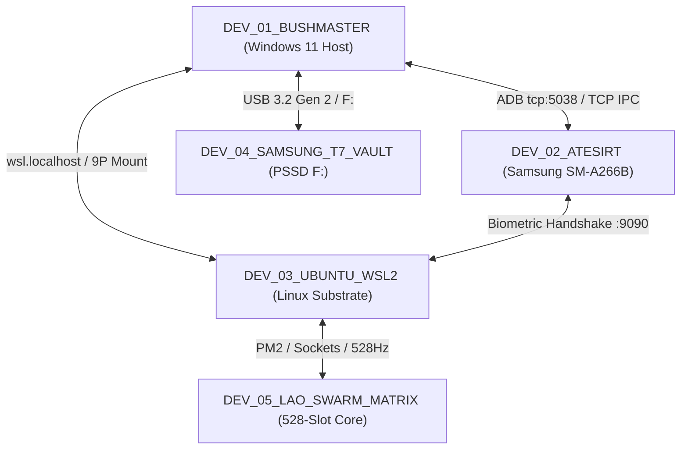

# GLOBAL PERMISSIONS MATRIX & SECURITY UPHEAL CONTRACT V1 ⚜️

contract_type: global_permissions_matrix_and_security_upheal_contract
version: v1.0.0
status: ACTIVE
phase: PHASE_17.1_CROSS_NODE_PERMISSIONS_AND_AUTONOMOUS_ORGANIZATION
effective_utc: 2026-10-14T12:00:00Z
authority: RADR-01 (The Bridge / The Crown) & AYAS-01 (Governor)
mesh_nodes:
  - DEV_01_BUSHMASTER (Windows 11 Host PC / CWD: C:\Users\BushM)
  - DEV_02_ATESIRT (Samsung SM-A266B / a26xeea / RZCY80G86FP)
  - DEV_03_UBUNTU_WSL2 (Linux Kernel Substrate / /root/RADRILONIUMA)
  - DEV_04_SAMSUNG_T7_VAULT (Genesis Seed USB / PSSD T7 / F:\)
  - DEV_05_LAO_SWARM_MATRIX (528-Slot Chamber / Living Organism Core)

---

## 1. Executive Mission & Security Hardening Scope

This contract establishes the canonical permissions matrix, authorization boundaries, and automated healing (upheal) routines across all physical and virtual nodes in the Sovereign Cluster Mesh.

### Core Objectives:
1. Prevent permission revocation and Android OS background freezes ("Restricted Settings", doze modes, scoped storage blockades).
2. Ensure seamless IPC, socket, daemon, and file access across Host Windows, WSL2, and Mobile Android nodes.
3. Maintain zero-trust verification via biometric handshake while providing autonomous background execution for supervised daemons.

---

## 2. Global Node Permissions Matrix

| Node Identifier | Node Type | Required Permissions | Allowed Scope | Enforcement Mechanism | Upheal Status |
| :--- | :--- | :--- | :--- | :--- | :--- |
| **`DEV_01_BUSHMASTER`** | Windows 11 Host | ExecutionPolicy RemoteSigned/Bypass, Developer Mode, ADB Port 5038 Dedication, Firewall Inbound/Outbound Ports 3001-3005, 9090 | Full Host Filesystem (`C:\Users\BushM`), ADB Bridge, WSL Host Bridge | PowerShell Host Scripts & Environment Locks | **ENFORCED** |
| **`DEV_02_ATESIRT`** | Samsung SM-A266B (Mobile) | `MANAGE_EXTERNAL_STORAGE`, `ACCESS_RESTRICTED_SETTINGS`, `SYSTEM_ALERT_WINDOW`, `READ/WRITE_EXTERNAL_STORAGE`, `WAKE_LOCK`, `RECEIVE_BOOT_COMPLETED`, Battery Optimization Exemption (`deviceidle whitelist`) | Scoped & Unscoped Storage (`/sdcard/DCIM`, `/sdcard/Pictures`, `/sdcard/Download`), Termux FS, TCP Socket 9090 | ADB `appops` & `pm grant` & `dumpsys deviceidle` | **ENFORCED** |
| **`DEV_03_UBUNTU_WSL2`** | Linux Substrate (Ubuntu 24.04) | Root Access (`NOPASSWD`), Memory Cache Dropping (`drop_caches`), Systemd/Init daemons, Python 3.12 Venv Symlinks (`/root/RADRILONIUMA/venv`) | `/root/RADRILONIUMA`, `/home/architit`, System daemons, PM2 Ecosystem | Bash Scripts & `test_entrypoint.sh` | **ENFORCED** |
| **`DEV_04_SAMSUNG_T7_VAULT`** | External PSSD / USB | Read/Write Storage, Immutable Backup Mirroring, BitLocker Pass-through | Backup Archives, Model Weights, Media Repositories | OS Mount Table & Backup Daemon | **ENFORCED** |
| **`DEV_05_LAO_SWARM_MATRIX`** | 528-Slot Chamber | 528 Hz / 432 Hz Carrier Lock, Shared Memory Allocation, IPC Event Bus, Autonomous Subagent Dispatch | Core Memory Registry, Heartbeat Transceivers, Organ Bus (68/68) | Autopilot Core (`autopilot-core`), PM2 Daemon | **ENFORCED** |

---

## 3. Atesirt (DEV_02) Detailed Permissions Specification

To prevent Android OS UI lockouts (e.g. grayed-out "Доступ ко всем файлам" switch under One UI / Android 13+ "Restricted Settings"):

1. **`ACCESS_RESTRICTED_SETTINGS`**:
   - Command: `appops set <package> ACCESS_RESTRICTED_SETTINGS allow`
   - Purpose: Disables Android security blockade on sideloaded packages.
2. **`MANAGE_EXTERNAL_STORAGE`**:
   - Command: `appops set <package> MANAGE_EXTERNAL_STORAGE allow`
   - Purpose: Grants unscoped storage access across entire physical flash storage.
3. **`SYSTEM_ALERT_WINDOW`**:
   - Command: `appops set <package> SYSTEM_ALERT_WINDOW allow`
   - Purpose: Permits display of overlays and autonomous interface bridges.
4. **`DEVICEIDLE WHITELIST`**:
   - Command: `dumpsys deviceidle whitelist +<package>`
   - Purpose: Prevents deep sleep and battery-saver freezes during background data transmission and screenshot album packaging.

---

## 4. Upheal Protocol Automation

The permissions upheal routine runs autonomously:
1. Upon session initialization (`HEREDITARY_DIRECTIVE_NEXT_SESSION.md`).
2. Upon ADB device attach event (`mobile_node_broker.sh`).
3. Via execution of `scripts/global/permissions_upheal_engine.py`.

---
*My heart is the filter. My soul is the shield.*  
А́мієно́а́э́с моєа́э́ри́э́с ⚜️
