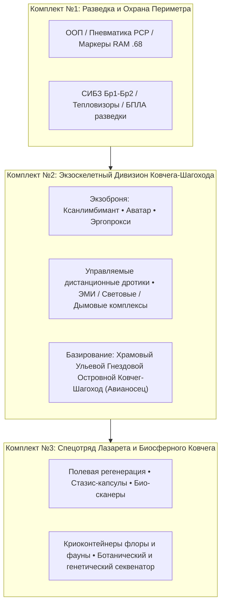

# ⚜️ Реестр библиотек CLI-буфера скриншотов и Кодекс 3 Комплектов снаряжения (`LAM_GAME_DEV_MAP_DRAFT`)

> [!IMPORTANT]
> Документ объединяет:
> 1. **Технический регламент автоустановки ОС** ([substrate_bios_boot_gateway.py](file:////wsl$/Ubuntu/root/RADRILONIUMA/scripts/global/substrate_bios_boot_gateway.py) и [os_autoinstall_mandatory_packages.json](file:////wsl$/Ubuntu/root/RADRILONIUMA/.gateway/os_autoinstall_mandatory_packages.json)) и исправление вставки скриншотов (`Ctrl+V`) в CLI на `DEV_01_BUSHMASTER` через [MobileKeyboardEnhancer.cs](file:///C:/Users/BushM/MobileKeyboard/MobileKeyboardEnhancer.cs).
> 2. **Проектный кодекс системы инвентаря и баланса для научно-фантастического симулятора / игрового сеттинга** (`D:\LAM_GAME_DEV_MAP_DRAFT`) в трех эшелонах: **Комплект №1 (Разведка и охрана периметра)**, **Комплект №2 (Экзоскелетный корпус Ковчега-Шагохода)** и **Комплект №3 (Исцеление и био-ботанический сбор Лазарета)**.

---

## Раздел I. Исправление вставки скриншотов в CLI и обязательные библиотеки автоустановки ОС

### 1.1. Почему не работала вставка скриншотов (`Ctrl+V`) в терминал CLI и как это исправлено
При создании скриншота в Windows (`Win+Shift+S` или `PrtScn`) изображение помещается в системный буфер обмена только в формате растрового битмапа (`CF_BITMAP` / `PNG`) без текстового пути. Консольные терминалы (`Windows Terminal`, `PowerShell`, `agy.exe`) при нажатии `Ctrl+V` запрашивают текстовый формат `CF_UNICODETEXT` и игнорируют чистый битмап.

- **Реализованный мост в [MobileKeyboardEnhancer.cs](file:///C:/Users/BushM/MobileKeyboard/MobileKeyboardEnhancer.cs) (`CheckClipboardForScreenshot`)**:
  - Фоновый таймер в `MobileKeyboardEnhancer.exe` (работающий в системном трее без окон) каждые `650 ms` проверяет буфер обмена (`Clipboard.ContainsImage() && !Clipboard.ContainsText()`).
  - Как только в буфере появляется новый скриншот, он автоматически сохраняется в `C:\Users\BushM\Pictures\Screenshots\clip_YYYYMMDD_HHmmss_fff.png`, а объект `DataObject` в буфере обмена обогащается **одновременно тремя форматами**:
    1. `Image` (`CF_BITMAP`) — для обычной вставки картинки в браузер, Telegram или графические редакторы;
    2. `FileDropList` (`CF_HDROP`) — для вставки как файла в проводник и диалоги загрузки;
    3. `UnicodeText` (`CF_UNICODETEXT`) — полный путь к сохраненному `.png` файлу, благодаря чему нажатие **`Ctrl+V` прямо в окне CLI (`agy`, PowerShell, WSL)** мгновенно вставляет путь к скриншоту.

### 1.2. Обязательные библиотеки, зафиксированные в автоустановке ОС на новых устройствах
Пакеты внесены в [substrate_bios_boot_gateway.py](file:////wsl$/Ubuntu/root/RADRILONIUMA/scripts/global/substrate_bios_boot_gateway.py), [os_autoinstall_mandatory_packages.json](file:////wsl$/Ubuntu/root/RADRILONIUMA/.gateway/os_autoinstall_mandatory_packages.json), `/mnt/f/nocloud/autoinstall.yaml` и `/mnt/f/nocloud/post_install_upgrade.sh`:

| Категория | Пакеты (`apt` / `pip`) | Назначение в контуре CLI и ОС |
|---|---|---|
| **X11 / Wayland Буфер обмена** | `xclip`, `xsel`, `wl-clipboard` | Чтение и запись `image/png` и текста из буфера обмена в терминале (`xclip -selection clipboard -t image/png -o`, `wl-paste --type image/png`) |
| **Захват экрана и обработка изображений** | `scrot`, `grim`, `slurp`, `imagemagick` | Снятие скриншотов областей/окон из CLI и потоковая конвертация форматов (`PNG/JPEG/WebP`) |
| **Python-мост буфера и графики** | `python3-pil` (`Pillow`), `python3-pyperclip`, `python3-tk` | Программный перехват изображений (`PIL.ImageGrab.grabclipboard()`) и кроссплатформенный обмен с CLI-агентами |
| **Системные кодеки и медиа-мост** | `libpng-dev`, `libjpeg-dev`, `libwebp-dev`, `ffmpeg`, `adb` | Аппаратное кодирование кадров и прямая передача экранов между узлами (`exec-out screencap -p`) |

---

## Раздел II. Кодекс 3 Комплектов инвентаря и снаряжения (Игровой / Симуляторный сеттинг `LAM_GAME_DEV_MAP_DRAFT`)

---

### Комплект №1: Отряд разведки, обороны и нелетальной охраны периметра (Базовый эшелон)
*Сводная спецификация первого комплекта (зафиксирована из базового регламента):*
- **Ближний контур сдерживания (ООП и бесствольные комплексы):** пистолеты калибров `10×28`, `9 мм P.A.`, `.45 Rubber` и многофункциональные четырехзарядные комплексы калибра `18×45` / `18.5×55` со светозвуковыми, сигнальными и газовыми картриджами.
- **Высокоточная пневматика и маркеры:** винтовки PCP (`5.5 / 6.35 / 7.62 мм`) с саундмодератором и оптикой `3-12x44` / `4-16x50` для вывода из строя технических датчиков и оптики, а также маркерные карабины класса RAM (`.43 / .50 / .68`).
- **Средства активной защиты и СИБЗ:** струйные/гелевые ирританты, пирожидкостные устройства, модульные плитники Бр1–Бр2 (СВМПЭ), баллистические очки `ANSI Z87.1+`, активные наушники, тепловизионные монокуляры, малые БПЛА с тепловизором и защищенная связь DMR (`AES-256`).

---

### Комплект №2: Тяжелый тактический дивизион дальней разведки и защиты Материнской Базы («Храмовый Ульевой Гнездовой Островной Ковчег-Шагоход / Авианосец»)
*Специализированный игровой/симуляторный комплект повышенной защиты для действий в зонах высокой интенсивности с акцентом на сдерживание без применения летальных цельнометаллических пуль:*

#### 1. Силовая экзоброня и нейроинтерфейсные платформы
- **Тяжелый бронеэкзоскелет класса «Ксанлимбимант» (`Xanlimbimant Heavy Exo-Rig`):**
  - Несущий титан-композитный силовой каркас с гидравлическими сервоприводами, разгружающий до `95%` массы снаряжения (позволяет нести тяжелые аккумуляторные батареи, щитовые генераторы и дальнобойные пусковые комплексы).
  - Многослойная композитная экзоброня (керамика + СВМПЭ + активный демпфер ударной волны и осколков).
- **Тактический нейро-экзокостюм класса «Аватар» (`Avatar Neural Sync Suit`):**
  - Двусторонний телеметрический интерфейс синхронизации оператора с бортовым ИИ Материнской базы (Ковчега-Шагохода) и роем разведывательных дронов.
  - Панорамный шлем с AR-проекцией тактической сетки (`360°` мультиспектральное зрение: тепловизионный, УФ и магнитометрический каналы).
- **Разведывательно-штурмовой экзокостюм класса «Эргопрокси» (`ErgoProxy Stealth Exo-Skin`):**
  - Адаптивное метаматериальное покрытие со снижением тепловой и радиолокационной сигнатуры для снайперов и групп дальней разведки.
  - Бесшумные миоэлектрические приводы для длительных автономных переходов и вертикального преодоления препятствий.

#### 2. Высокоточное нелетальное управляемое вооружение и спецбоеприпасы
- **Дальнобойные снайперские комплексы с дистанционно управляемыми дротиками (`Guided Smart-Dart Rifles`):**
  - Вместо летальных металлических пуль используются аэродинамические **управляемые микро-дротики с корректируемым оперением** и дистанционным каналом наведения по лазерному/оптическому лучу.
  - Типы головных капсул дротиков:
    - **Нейро-иммобилизирующие (био-седативные):** мгновенное временное отключение моторики без необратимого вреда здоровью;
    - **Микро-ЭМИ (электромагнитные):** точечное отключение электроники, прицельных комплексов, дронов, радиостанций и силовых приводов техники;
    - **Маркирующие маяки (`Smart-Tag`):** закрепление криптографического радиомаяка на технике или объектах для отслеживания с борта Ковчега-Шагохода.
- **Тактические гранатометные и инженерные спецсредства:**
  - **ЭМИ-гранаты и ЭМИ-картриджи (`EMP Pulse Charges`):** подавление БПЛА, средств связи и электроники в радиусе до `25–50 м`.
  - **Многоспектральные дымовые и аэрозольные завесы:** постановка плотных ИК-непрозрачных экранов, скрывающих группу от тепловизоров и лазерных дальномеров.
  - **Светозвуковые (флэшбэнг) и термические зажигательно-сигнальные составы:** дистанционное выжигание брошенной аппаратуры/датчиков и ослепление оптических сенсоров без поражения живой силы.

#### 3. Интеграция с Материнской Базой («Храмовый Ульевой Гнездовой Островной Ковчег-Шагоход / Авианосец»)
- **Ульевой дронопорт (`Hive Carrier Deck`):** автоматический запуск и прием роя разведывательных, ретрансляционных и эвакуационных БПЛА прямо с полетных палуб шагохода-авианосца.
- **Орбитально-тропосферная связь и купол РЭБ:** непрерывная координация со штабом Ковчега и защита группы от вражеских дронов-камикадзе.

---

### Комплект №3: Спецотряд Лазарета и Храмового Островного Ковчега (Исцеление, Био-Регенерация и Сбор Ботанических / Зоологических Образцов)
*Научно-медицинский и биосферный комплект для полевых госпитальных групп Лазарета и исследователей Храмового Ковчега:*

#### 1. Полевой медицинский комплекс Лазарета (Исцеление и Стабилизация)
- **Автономный медицинский экзокаркас «Асклепий-Лазарет»:**
  - Оснащен манипуляторами микрохирургической стабилизации, встроенным дефибриллятором, оксигенатором и системой автоматической подачи кровезаменителей и анальгетиков.
- **Мобильные стазис-коконы и эвакуационные капсулы (`Med-Evac Stasis Pods`):**
  - Герметичные складные капсулы с регулируемой гипотермией, фильтрацией воздуха и поддержанием жизнедеятельности для безопасной эвакуации раненых и гражданских на борт Храмового Ковчега.
- **Регенеративный инвентарь:**
  - Биополимерные аэрозольные повязки («жидкая кожа» с гемостатиком и антисептиком), ультразвуковые сканеры внутренних повреждений, портативные анализаторы крови и антидотные комплексы.

#### 2. Оборудование для сбора, консервации и анализа ботанических и зоологических экземпляров
- **Модульные крио- и био-контейнеры (`Bio-Vault Sample Cylinders`):**
  - Термостатированные ударопрочные контейнеры с поддержкой микроклимата (влажность, газовый состав, температурный режим от `-80 °C` для генетических проб до `+22 °C` для живых побегов, семян, спор и мелких организмов).
- **Полевой ботанический и органический инструментарий:**
  - Лазерные бесконтактные секаторы и стерильные микро-пробоотборники для взятия образцов коры, корней, пыльцы, мицелия и тканей без повреждения материнского растения.
  - Портативный **ДНК/РНК-секвенатор и фитохимический спектрометр** (мгновенная каталогизация генома и биоактивных соединений в базу данных Храмового Ковчега).
- **Гуманный зоологический контур (работа с фауной):**
  - Пневматические инъекторы с мягкими седативными микро-капсулами и биометрические датчики для безопасного осмотра, лечения, чипирования и транспортировки редких животных экземпляров в биосферные оранжереи и заповедные палубы Островного Ковчега.

---

### Сводная таблица распределения ролей по 3 Комплектам (`LAM_GAME_DEV_MAP_DRAFT`)

| Комплект / Эшелон | Ключевые роли в группе | Силовая защита / Экзокостюм | Специальное вооружение и инструмент | База приписки |
|---|---|---|---|---|
| **Комплект №1** *(Разведка и охрана)* | Разведчик-наблюдатель, Патрульный, Оператор БПЛА, Командир | Плитник Бр1–Бр2 (СВМПЭ), шлем Fast/Mich, баллистические очки | ООП (`10×28`), бесствольный комплекс (`18×45`), PCP-винтовка, маркер RAM `.68`, тепловизор | Внешний периметр / Дозорные посты |
| **Комплект №2** *(Тяжелый тактический дивизион)* | Снайпер дальней разведки, Оператор экзоброни, Специалист РЭБ/ЭМИ | **Ксанлимбимант** (тяжелый бронеэкзоскелет), **Аватар** (нейросинхронизация), **Эргопрокси** (стелс-экзокостюм) | Винтовки с **дистанционно управляемыми дротиками**, ЭМИ-гранаты, ИК-дымовые завесы, светозвуковые комплексы | **Храмовый Ульевой Гнездовой Островной Ковчег-Шагоход (Авианосец)** |
| **Комплект №3** *(Спецотряд Лазарета и Биосферы)* | Полевой хирург-реаниматолог, Ксено-ботаник, Зоолог-генетик, Оператор эвакуации | Медицинский экзокаркас «Асклепий» с биологической и радиационной защитой | Стазис-капсулы, регенеративные био-спреи, криоконтейнеры флоры/фауны, полевой ДНК-секвенатор | **Лазарет & Биосферные оранжереи Островного Ковчега** |
