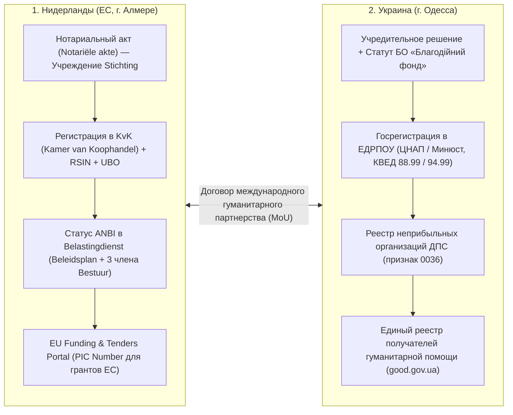

# ⚜️ Таблица приоритизации чатов Telegram и уровень уверенности в необходимости ответа

> [!IMPORTANT]
> Данные получены прямым подключением через `Telethon MTProto` ([telegram_tdata_priority_scanner.py](file:///C:/Users/BushM/.gemini/antigravity-cli/brain/d1f5395f-beb8-4b79-9607-d0ada3498e59/scratch/telegram_tdata_priority_scanner.py)) к двум авторизованным сессиям Telegram Desktop (`C:\Users\BushM\AppData\Roaming\Telegram Desktop\tdata`):
> 1. **Аккаунт №1 (UA):** `𝕶𝖔𝖇𝖆𝖗𝖉 ☬ Trianium 🪷` (`@Kirihanis` • `+380735214183`)
> 2. **Аккаунт №2 (NL/EU):** `Trianiuma` (`@Elafea_Triania` • `+31649033064`)
> Полная машиночитаемая матрица сохранена в [/root/RADRILONIUMA/.gateway/telegram_chat_priority_matrix.json](file:////wsl$/Ubuntu/root/RADRILONIUMA/.gateway/telegram_chat_priority_matrix.json).

---

## 1. Аккаунт №1: `𝕶𝖔𝖇𝖆𝖗𝖉 ☬ Trianium 🪷` (`@Kirihanis` • `+380735214183`)

### 1.1. Личные контакты и целевые рабочие группы (`P0` – `P2`)

| Уверенность (%) | Приоритет | Контакт / Чат | Тип | Непрочит. | Посл. реплика | Дата (UTC) | Последнее сообщение / Причина необходимости ответа |
|---|---|---|---|---|---|---|---|
| **96%** | `P0_CRITICAL` | **Мамиябога** | Личный | `0` | **IN (Собеседник)** | `2026-10-17 04:44` | Прислала ссылку `https://youtu.be/Sm7t5qIuk6Y...` сегодня утром — **входящее от близкого контакта без вашего ответа** |
| **96%** | `P0_CRITICAL` | **Михагут** (`@mishan911`) | Личный | `0` | **IN (Собеседник)** | `2026-10-13 22:53` | *«Привіт Друже Слухай, задум у тебе, звісно, масштабний. Цікаво, що ти в...»* — **развернутый входящий отклик на ваше описание проекта в Алмере, ждет вашего ответа** |
| **85%** | `P1_KEY_CONTACT` | **Бабушка 🩵** | Личный | `0` | `OUT (Вы)` | `2026-10-13 21:51` | Ваше сообщение о запуске проекта в Алмере (`13.10`) — **ключевой родственный контакт (Одесса/Украина), рекомендуется контрольная связь** |
| **85%** | `P1_KEY_CONTACT` | **Папаций 🩶** (`@avto_serj`) | Личный | `0` | `OUT (Вы)` | `2026-10-15 12:16` | *«Автодом — это иллюзия свободы. Жизнь в нём невозможна в статике...»* — **ключевой семейный контакт, ожидание ответа** |
| **85%** | `P1_KEY_CONTACT` | **Кен** (`@Ken1Ryuguji1`) | Личный | `0` | `OUT (Вы)` | `2026-10-17 17:47` | *«Пздц включи компас на север) на лево»* — **активный сегодняшний диалог (`17.10`), оперативная координация** |
| **85%** | `P1_KEY_CONTACT` | **Vachargrd** (`@kisssslaa`) | Личный | `0` | `OUT (Вы)` | `2026-10-17 12:30` | *«Но работать только на нал либо ждать»* — **активный сегодняшний рабочий диалог (`17.10`)** |
| **82%** | `P1_CORE_PROJECT` | **RADRILONIUMA🌱** | Группа ядра | `0` | **IN** | `2026-10-11 17:34` | Основная группа проекта — проверка фиксации последних обновлений |
| **82%** | `P1_CORE_PROJECT` | **Ušumgal⚜** | Группа ядра | `0` | **IN** | `2026-10-11 15:44` | Командная группа ядра — проверка статуса |
| **78%** | `P1_RESIDENCE_HQ` | **Офіційна сторінка Alnovum, Almere 🇺🇦🇳🇱** | Группа локации | `3` | **IN** | `2026-10-17 05:50` | *«Доброго ранку всім👋 Сьогодні на локації буде бус-перевізник о 17:50...»* — офіційні оголошення локації в Алмере |
| **64%** | `P2_FOLLOW_UP` | **Mini Ghost // Void** (`@Karl_Galageer`) | Личный | `0` | `OUT (Вы)` | `2026-10-13 21:51` | Отправлено приглашение в проект в Алмере (`13.10`), собеседник еще не ответил |
| **64%** | `P2_FOLLOW_UP` | **Rayomi 🦍** (`@mniarng`) | Личный | `0` | `OUT (Вы)` | `2026-10-13 21:51` | Отправлено приглашение в проект в Алмере (`13.10`), собеседник еще не ответил |
| **64%** | `P2_FOLLOW_UP` | **-=═╬ 𝕲𝕺𝕷𝕺𝖁𝕶𝕺 ╬═=-** (`@golovko1010`) | Личный | `0` | `OUT (Вы)` | `2026-10-13 21:51` | Отправлено приглашение в проект в Алмере (`13.10`), собеседник еще не ответил |
| **64%** | `P2_FOLLOW_UP` | **Zoradard ✊** (`@Karl_Liney`) | Личный | `0` | `OUT (Вы)` | `2026-10-13 21:51` | Отправлено приглашение в проект в Алмере (`13.10`), собеседник еще не ответил |
| **64%** | `P2_FOLLOW_UP` | **Sliiimee** (`@slime_language13`) | Личный | `0` | `OUT (Вы)` | `2026-10-13 21:51` | Отправлено приглашение в проект в Алмере (`13.10`), собеседник еще не ответил |
| **64%** | `P2_FOLLOW_UP` | **Чапи** | Личный | `0` | `OUT (Вы)` | `2026-10-13 21:51` | Отправлено приглашение в проект в Алмере (`13.10`), собеседник еще не ответил |
| **64%** | `P2_FOLLOW_UP` | **Nik ✊** (`@silkkooo`) | Личный | `0` | `OUT (Вы)` | `2026-10-13 21:51` | Отправлено приглашение в проект в Алмере (`13.10`), собеседник еще не ответил |
| **64%** | `P2_FOLLOW_UP` | **Настёна** (`@Mini_Barbie`) | Личный | `0` | `OUT (Вы)` | `2026-10-13 21:51` | Отправлено приглашение в проект в Алмере (`13.10`), собеседник еще не ответил |
| **64%** | `P2_FOLLOW_UP` | **Сеасония** (`@sofi_lyna`) | Личный | `0` | `OUT (Вы)` | `2026-10-13 21:51` | Отправлено приглашение в проект в Алмере (`13.10`), собеседник еще не ответил |
| **64%** | `P2_FOLLOW_UP` | **Слав** (`@eSTeSSss`) | Личный | `0` | `OUT (Вы)` | `2026-10-13 21:51` | Отправлено приглашение в проект в Алмере (`13.10`), собеседник еще не ответил |
| **64%** | `P2_FOLLOW_UP` | **Alexoid ✊** (`@TheSashaMiami`) | Личный | `0` | `OUT (Вы)` | `2026-10-13 21:51` | Отправлено приглашение в проект в Алмере (`13.10`), собеседник еще не ответил |
| **64%** | `P2_FOLLOW_UP` | **Oleksii Dovbnia** | Личный | `0` | `OUT (Вы)` | `2026-10-13 21:51` | Отправлено приглашение в проект в Алмере (`13.10`), собеседник еще не ответил |
| **60%** | `P1_CORE_PROJECT` | **6-ВзглядАсасина-6** | Группа | `0` | `OUT (Вы)` | `2026-10-13 21:51` | Опубликовано описание проекта в Алмере |
| **58%** | `P2_ACTIVE_DIALOG` | **Наздарданд ✊** (`@Zadoya015`) | Личный | `0` | `OUT (Вы)` | `2026-10-17 02:59` | *«Заебал меня цей капитализм»* — последняя реплика ваша сегодня ночью |
| **58%** | `P2_ACTIVE_DIALOG` | **Дима 10** | Личный | `0` | `OUT (Вы)` | `2026-10-15 22:46` | *«Личну лучше твой текущий укр оставить»* — последняя реплика ваша |
| **58%** | `P2_ACTIVE_DIALOG` | **Вамибарк ✊** (`@Wanderfate`) | Личный | `0` | `OUT (Вы)` | `2026-10-13 23:05` | *«+++)»* — диалог завершен подтверждением |

### 1.2. Общие публичные группы Нидерландов (`P3` — ответ не требуется без личного `@упоминания`)

| Уверенность (%) | Приоритет | Группа | Непрочит. | Личных `@` | Статус |
|---|---|---|---|---|---|
| **18%** | `P3_PUBLIC_GROUP` | `Українці в Альмере, Нідерланди` | `109` | `0` | Общий городской чат (без личных обращений) |
| **18%** | `P3_PUBLIC_GROUP` | `Нідерланди Амстердам` (`@NiderlandyUA`) | `1305` | `0` | Общий чат (без личных обращений) |
| **18%** | `P3_PUBLIC_GROUP` | `Нідерландська криївка` (`@nlkryivka`) | `42211` | `0` | Массовый чат (без личных обращений) |
| **18%** | `P3_PUBLIC_GROUP` | `Нидерланды | Экспаты | Чат` (`@netherlandschat`) | `216` | `0` | Общий чат / реклама |
| **18%** | `P3_PUBLIC_GROUP` | `Украинцы в Нидерландах` (`@UkrainiansintheNetherlands2`) | `56` | `0` | Общий чат перевозчиков |
| **18%** | `P3_PUBLIC_GROUP` | `🇺🇦UAjobsNL🇳🇱 job Netherland` (`@uajobsnl`) | `8` | `0` | Доска вакансий и объявлений |

---

## 2. Аккаунт №2: `Trianiuma` (`@Elafea_Triania` • `+31649033064`)

| Уверенность (%) | Приоритет | Контакт / Чат | Тип | Непрочит. | Посл. реплика | Дата (UTC) | Последнее сообщение / Причина необходимости ответа |
|---|---|---|---|---|---|---|---|
| **82%** | `P1_CORE_PROJECT` | **RADRILONIUMA🌱** | Группа ядра | `35` | **IN** | `2026-10-11 17:34` | `35` непрочитанных сообщений на голландском аккаунте `@Elafea_Triania` |
| **82%** | `P1_CORE_PROJECT` | **Ušumgal⚜** | Группа ядра | `8` | **IN** | `2026-10-11 15:44` | `8` непрочитанных сообщений в командной группе |
| **82%** | `P1_CORE_PROJECT` | **The Last Ray** | Группа ядра | `1` | **IN** | `2026-10-11 15:10` | Входящая ссылка `https://share.gemini.google/UsEXTpOtZzKA` |
| **78%** | `P1_RESIDENCE_HQ` | **Best Western Plus** | Группа резиденции | `557` | **IN** | `2026-10-17 17:48` | *«НЕ ЧУЮ ???»* — активное обсуждение в чате резиденции (Алмере) |
| **78%** | `P1_RESIDENCE_HQ` | **Louis Armstrongweg 2.0** | Группа резиденции | `14` | **IN** | `2026-10-16 13:20` | *«У середу, 18 листопада, ми разом з вами організовуємо вечір...»* — объявления локации |
| **72%** | `P1_HIGH` | **Владислав** (`@vds000001`) | Личный | `0` | **IN (Собеседник)** | `2026-09-27 18:22` | Последнее сообщение — входящее от собеседника |
| **72%** | `P1_HIGH` | **Taco** | Личный | `0` | **IN (Собеседник)** | `2026-09-23 23:14` | Последнее сообщение — входящее от собеседника |
| **72%** | `P1_HIGH` | **Brok** | Личный | `0` | **IN (Собеседник)** | `2026-09-07 17:05` | Последнее сообщение — входящее от собеседника |
| **65%** | `P1_KEY_CONTACT` | **Мамиябога** | Личный | `0` | `OUT (Вы)` | `2026-06-25 07:51` | Основное общение перенесено на аккаунт `@Kirihanis` (`17.10.2026`) |
| **65%** | `P1_KEY_CONTACT` | **Братишка Денис** | Личный | `0` | `OUT (Вы)` | `2026-06-25 07:37` | Семейный контакт (последнее сообщение со ссылкой-приглашением от вас) |

---

## 3. Полный контекст последних сообщений (`P0/P1`) и готовые черновики ответов

### 3.1. `Михагут` (`@mishan911`) — Уверенность: **96% (`P0_CRITICAL`)**
- **Последнее входящее сообщение (`2026-10-13 22:53 UTC`):**
  > *«Привіт Друже Слухай, задум у тебе, звісно, масштабний. Цікаво, що ти все це через ШІ намагаєшся реалізуватии. Але я так розумію, що технічну частину ти зараз тільки будуєш? А що з самим фондом? Уже є реєстрація, партнери, фінансування чи поки все на етапі планування? І ще цікаво, для чого тобі одразу команда на 50 людей? Просто хочу зрозуміти, наскільки далеко ти вже просунувся.»*
- **Готовый черновик ответа (`Draft Reply`):**
  > Привіт! Технічне ядро на ноутбуці та в Linux (WSL2 + локальний шлюз управління і зв'язок з мобільним вузлом) ми вже підняли й протестували — система працює автономно 24/7.
  > По юридичній частині ми зараз готуємо подвійну реєстрацію:
  > 1) У Нідерландах (Алмере) — реєстрація **Stichting** через нотаріуса і **KvK** з подачею на статус **ANBI** (щоб мати офіційний доступ до європейських грантів та благодійних фондів ЄС).
  > 2) В Україні (Одеса) — дзеркальний **Благодійний фонд (БО «БФ»)** зі статусом неприбутковості (`0036`) та реєстрацією в системі гуманітарної допомоги.
  > Щодо команди до 50 людей на стажування: це розподілений резерв під три зміни 24/7 (диспетчери координації, грантрайтери під програми ЄС, юридичний супровід, медіа та IT/інженери), щоб не залежати від однієї людини і перекривати всі напрямки паралельно. Якщо тобі цікаво підключитися до одного з контурів — давай обговоримо!

---

### 3.2. `Мамиябога` — Уверенность: **96% (`P0_CRITICAL`)**
- **Последние сообщения (`2026-10-17 03:39 – 04:44 UTC`):**
  - **Вы (`03:34`):** *«То уже в списке их целей» / «Его посадили»*
  - **Мамиябога (`03:39`):** `https://youtu.be/oLCCQ_zMgCA?is=IufB4V8LKj6nPJ4b` — *«Вот посмотри, все очень подробно.»*
  - **Мамиябога (`04:44`):** `https://youtu.be/Sm7t5qIuk6Y?is=ZM4HjQAog0GrZ_Qo`
- **Готовый черновик ответа (`Draft Reply`):**
  > Принял, спасибо! Обе ссылки получил, посмотрю подробно. Я сейчас на связи, донастраиваю рабочий контур и документы по фонду. Как ты себя чувствуешь?

---

### 3.3. `Vachargrd` (`@kisssslaa`) — Уверенность: **85% (`P1_KEY_CONTACT`)**
- **Последние сообщения (`2026-10-17 12:28 – 12:30 UTC`):**
  - **Vachargrd (`12:28`):** `[Прислал документ / файл]`
  - **Вы (`12:28 – 12:30`):** *«Сейчас неудобно» / «Наберу минут через 20 30» / «Но работать только на нал либо ждать»*
- **Готовый черновик ответа (`Draft Reply`):**
  > Я освободился после настройки системы, документ вижу. Когда тебе удобно созвониться на пару минут, чтобы обсудить детали?

---

### 3.4. `Бабушка 🩵` — Уверенность: **85% (`P1_KEY_CONTACT`)**
- **Последние сообщения (`2026-10-12 – 2026-10-13 UTC`):**
  - Отправлены резолюция и описание запуска координационного штаба и международного фонда в Алмере (`13.10 21:51`). Ответа пока не было.
- **Готовый черновик ответа (`Draft Reply`):**
  > Бабушка, привет! Как твоё самочувствие и как обстановка в Одессе? Напиши, пожалуйста, пару слов или маякни, когда будешь на связи.

---

### 3.5. `Папаций 🩶` (`@avto_serj`) — Уверенность: **85% (`P1_KEY_CONTACT`)**
- **Последние сообщения (`2026-10-15 11:52 – 12:16 UTC`):**
  - **Папаций (`11:52`):** *«Да, интересная идея. Подобное было, видел, семья поселилась в автодоме и постоянно переезжала.»*
  - **Вы (`12:16`):** *«Автодом — это иллюзия свободы. Жизнь в нём невозможна в статике...»*
- **Готовый черновик ответа (`Draft Reply`):**
  > Как у вас дела и как обстановка? Мы сейчас параллельно готовим документацию под официальную регистрацию фонда в Нидерландах и в Украине (Одесса). Как будешь свободен — выходи на связь.

---

### 3.6. `Дима 10` — Уверенность: **58% (`P2_ACTIVE_DIALOG`)**
- **Последние сообщения (`2026-10-15 22:45 – 22:46 UTC`):**
  - **Дима 10 (`22:45`):** *«Рабочий личный. Или какой там нужно. Но мой нынешний аккаунт я не хочу трогать. Он сильно много к чему привязан»*
  - **Вы (`22:46`):** *«Мне рабочий для тебя полезнее будет» / «Личну лучше твой текущий укр оставить»*
- **Готовый черновик ответа (`Draft Reply`):**
  > Да, твой личный украинский аккаунт вообще не трогаем — оставляй его чисто для себя. Под рабочие задачи проекта просто заведем отдельный рабочий профиль.

---

## 4. Юридический чек-лист официальной регистрации Фонда / Лазарета в ЕС (Нидерланды, Алмере) и в Украине (Одесса)

### 4.1. Контур 1: Нидерланды (ЕС, Алмере) — `Stichting` + `ANBI`
1. **Организационно-правовая форма:** **`Stichting`** (Некоммерческий фонд по праву Нидерландов, `Boek 2 Burgerlijk Wetboek`). Не требует уставного капитала, идеально подходит для гуманитарных, медицинских, эвакуационных и научно-исследовательских миссий и получения европейских грантов.
2. **Обязательный пакет документов для нотариуса (`Notaris` или онлайн-платформы вроде `Ligo.nl` / `Firm24` / нотариат в Almere):**
   - **Наименование фонда (`Statutaire naam`):** например, *Stichting Trianiuma Med-Rescue & Humanitarian Corps* (местонахождение: *Gemeente Almere, Nederland*).
   - **Уставная цель (`Statutair doel`):** гуманитарная помощь, медицинская эвакуация и реабилитация (Лазарет), защита гражданского населения, экологические и биосферные исследования.
   - **Состав Совета директоров (`Bestuur`):** для получения налогового статуса **`ANBI`** требуется минимум **3 независимых члена правления** (не состоящих в близком родстве и без единоличного контроля бюджета одним лицом — правило *beschikkingsmacht-criterium*):
     1. Председатель (`Voorzitter`);
     2. Секретарь (`Secretaris`);
     3. Казначей (`Penningmeester`).
   - **Вознаграждение правления:** в уставе фиксируется, что члены `Bestuur` не получают коммерческой зарплаты за само членство в совете (только компенсацию фактических расходов `onkostenvergoeding` и небольшое `vacatiegeld`), что является строгим требованием для статуса `ANBI`.
   - **Ликвидационная оговорка (`Liquidatiebepaling`):** при закрытии фонда остаток средств направляется исключительно другой организации со статусом `ANBI` с аналогичной целью.
3. **Регистрация в Торговой палате (`Kamer van Koophandel — KvK`) и `UBO-register`:**
   - Нотариус автоматически передает акт в `KvK`, после чего фонд получает **`KvK-nummer`** и налоговый номер юридического лица **`RSIN`**.
   - Одновременно заполняется реестр `UBO` (в случае `Stichting` в качестве условных `UBO` указываются члены правления `Bestuur` из устава).
4. **Публичный план политики (`Beleidsplan`) и подача на статус `ANBI` в `Belastingdienst`:**
   - На сайте/портале фонда публикуются: `RSIN`, контакты, состав `Bestuur`, `Beleidsplan` (многолетний план деятельности, способы привлечения и расходования средств) и финансовая отчетность.
   - Подается форма *Aanvraag beschikking ANBI* в налоговую службу Нидерландов (`Belastingdienst`).
5. **Аккредитация в грантовой системе Евросоюза:**
   - Регистрация организации на портале **EU Funding & Tenders Portal (`ECAS / EU Login`)** для получения 9-значного идентификатора **`PIC (Participant Identification Code)`** (даёт доступ к программам *EU4Health*, *Horizon Europe*, *Erasmus+*, *DG ECHO*).

---

### 4.2. Контур 2: Украина (г. Одесса) — `Благодійна організація «Благодійний фонд» (БО «БФ»)`
1. **Организационно-правовая форма:** **`Благодійна організація «Благодійний фонд»`** (по Закону Украины *«Про благодійну діяльність та благодійні організації»*). Регистрация бесплатная (административный сбор = `0 грн`).
2. **Пакет документов для подачи государственному регистратору (ЦНАП г. Одессы или нотариус):**
   - **Заявление о государственной регистрации юрлица (Форма 2)** (сразу с отметкой о включении в Реестр неприбыльных учреждений и организаций!).
   - **Решение учредителя (или Протокол учредительного собрания)** о создании БО «БФ», утверждении Устава и назначении руководителя (Директора / Главы правления в Одессе).
   - **Устав (`Статут`) БО «БФ»:** содержит обязательные нормы ст. 133.4 Налогового кодекса Украины (запрет распределения доходов между учредителями и передача активов другой неприбыльной организации или в бюджет в случае ликвидации; административные расходы фонда не превышают `20%` дохода за год).
   - **Структура собственности и данные КБВ** (конечных бенефициарных владельцев или обоснование их отсутствия у БФ).
   - **Коды КВЕД:** `88.99` *(Надання іншої соціальної допомоги без забезпечення проживання, н.в.і.у.)* — основной; дополнительно `94.99` *(Діяльність інших громадських організацій)* и `86.90` *(Інша діяльність у сфері охорони здоров'я)*.
3. **Налоговый статус и гуманитарный реестр:**
   - Получение выписки из ЕДРПОУ и включение в **Реєстр неприбуткових установ та організацій** ДПС Украины (код признака неприбыльности **`0036`** — благотворительная организация).
   - Открытие мультивалютных счетов (`UAH / EUR / USD`) в украинском банке.
   - Регистрация фонда с помощью КЭП руководителя в **Автоматизированной системе регистрации гуманитарной помощи Минсоцполитики Украины (`good.gov.ua`)** — присвоение уникального номера получателя гуманитарной помощи для беспошлинного ввоза медицинского оборудования, медикаментов, транспорта и оснащения из Нидерландов (от нидерландского `Stichting`).

---

## 5. Живой API-контур приоритизации на шлюзе (`:3001` / `:3000`)

Маршрут **`GET /api/telegram/priorities`** добавлен в [/root/workspace/gateway/index.js](file:////wsl$/Ubuntu/root/workspace/gateway/index.js) и доступен по адресам:
- `http://127.0.0.1:3001/api/telegram/priorities`
- `http://192.168.137.1:3001/api/telegram/priorities`

Возвращает актуальный JSON-слепок обоих аккаунтов (`accounts`) и полные тексты последних сообщений ключевых диалогов (`top_messages`).
